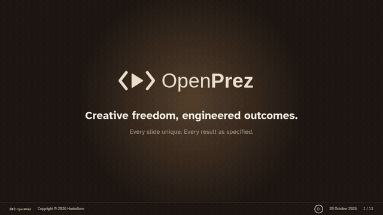

# OpenPrez


[](https://reporanker.com/repos/haskelium/openprez)

[**Showcase**](https://haskelium.github.io/openprez/) | [Read the Docs](docs/README.md)



OpenPrez is a code-authored presentation foundation: a local, player-only web app that presents one React/TypeScript slide deck. It supports bespoke React compositions with animation, flow lines, guided step-revealed diagrams, speaker notes, PDF export, and a fixed 1920x1080 stage. There is no backend, editor, deck picker, or runtime LLM integration; decks are authored in source code and bundled at build time.

**Your deck lives in a fork of this repository.** Fork it, and `presentation/` — which ships as a starter deck — becomes your presentation source, with a live upstream link for foundation updates. The starter deck's first slide explains how to replace it and links to the showcase. The full lifecycle (fork, author, update, semver) is in [Starting your deck](docs/starting-your-deck.md).

**Start from documents:** give your authoring agent PDFs, PowerPoints, Word documents, spreadsheets, Markdown or other readable sources, or place them in the Git-ignored `sources/` inbox at the repository root. The workflow can retain a curated reference, selected originals, both or neither—with your explicit approval. See [Build from reference documents](openprez/README.md#build-from-reference-documents).

## Run

Start with the dev server: it presents the starter deck, a one-slide overview that explains how to turn it into your own presentation and links to the showcase for inspiration:

```sh
pnpm install
pnpm dev      # live reload at http://localhost:5173, presenting the starter deck
pnpm start    # builds, then serves at http://localhost:4173: use this to present
```

Requirements: Node.js `>=24` and pnpm.

| Command              | Purpose                                                                                                              |
| -------------------- | -------------------------------------------------------------------------------------------------------------------- |
| `pnpm dev`           | Start Vite with live reload; presents the starter deck, and the showcase at `/showcase.html`.                        |
| `pnpm start`         | Build and serve the production bundle.                                                                               |
| `pnpm prez`          | Build a self-contained single-file presentation at `dist/prez.html`.                                                 |
| `pnpm prez:showcase` | Build the showcase deck as the single-file artifact (used by the GitHub Pages demo).                                 |
| `pnpm build`         | Produce the static production bundle.                                                                                |
| `pnpm typecheck`     | Run TypeScript without emitting files.                                                                               |
| `pnpm lint`          | Biome check without fixes (lint and format verification).                                                            |
| `pnpm format`        | Apply Biome formatting fixes.                                                                                        |
| `pnpm boundaries`    | Check resolved import ownership rules only.                                                                          |
| `pnpm test`          | Run the complete Vitest suite.                                                                                       |
| `pnpm test:browser`  | Run focused Chromium interactions, export and standalone-file checks; requires an installed Chromium-family browser. |
| `pnpm check`         | Apply Biome fixes, check import boundaries, type-check, and build.                                                   |
| `pnpm validate`      | Run the non-mutating CI validation gate, including all unit tests.                                                   |

### Share the build

`dist/` is plain static files, but browsers won't run it from `file://`; serve it from any static file server. The build loads `/assets/...` from the site root, so serve `dist/` at the root of a host, not a subfolder.

For a single-file artifact, run `pnpm prez`. It writes `dist/prez.html` with the JavaScript, CSS, fonts, images, and other emitted assets embedded in the HTML. The file can be copied or opened locally without neighboring build files. It is generated output; do not edit it by hand. To package the showcase instead, run `pnpm prez:showcase`. Each command validates a versioned manifest for its own build flavor before publishing output. Maintainer/CI builds can set distinct directories, for example `OPENPREZ_BUILD_DIR=dist/prez-user pnpm prez` and `OPENPREZ_BUILD_DIR=dist/prez-showcase pnpm prez:showcase`.

## Present

| Do                               | Keys and buttons                  |
| -------------------------------- | --------------------------------- |
| Next / previous step             | Right arrow or Space / Left arrow |
| Next / previous slide            | Down arrow / Up arrow             |
| Next / previous key frame        | Shift+Right / Shift+Left          |
| First / last slide               | Home / End                        |
| Speaker notes (presenter window) | N                                 |
| Fullscreen                       | F                                 |

The footer buttons are, in order, Previous slide, Previous key frame, Previous step, Next step, Next key frame, Next slide, Speaker notes and Export PDF. Page Up and Page Down don't navigate. The position is kept in the URL (`#/slide/step`), so a reload returns to the same place.

### Rehearse with speaker notes

Speaker notes (or `N`) opens a presenter window for rehearsing, or for presenting from a second screen. It shows the current slide's notes, the current and next step as static previews, the main session's elapsed timer, and navigation controls. The main window owns position and timers; presenter commands and versioned snapshots synchronize in the browser. If BroadcastChannel is unavailable, the action explains that synchronized notes cannot open. Temporary heartbeat loss keeps notes open with remote controls disabled until a fresh snapshot restores the current position and timers. Press `N` in the presenter to close it; confirmed main-window close or reload ends the notes session.

## Layout

| Folder          | Holds                                                                                                                                                |
| --------------- | ---------------------------------------------------------------------------------------------------------------------------------------------------- |
| `core/`         | The reusable foundation: player, stage, navigation, theme plumbing, template contract, shared components.                                            |
| `presentation/` | The home of your own deck (`deck.tsx`, `slides/`, `assets/`); ships as a starter deck whose single guidance slide your first change replaces.        |
| `showcase/`     | The OpenPrez showcase deck: a reference for foundation capabilities, served by the dev server at `/showcase.html`; never part of a production build. |
| `templates/`    | Runtime visual templates: the active one supplies the palette and the footers, and gets checked, linted and bundled like app code.                   |

`app/main.tsx` is the composition entry point: it selects the user deck (`@presentation/deck`) and the one active template and hands both to the generic player. `app/showcase.tsx` is a development-only reference entry presenting the showcase deck at `/showcase.html`; it is not a production build input, so `pnpm build` and `pnpm prez` contain exactly your deck (the maintainer-facing `pnpm prez:showcase` packages the showcase deliberately for demo deployments). Foundation code does not import deck or template code; deck code imports foundation APIs through `@core`.

## Repository map

| Path            | Role                                                                                                  |
| --------------- | ----------------------------------------------------------------------------------------------------- |
| `core/`         | Generic player, stage, navigation, presenter view, export support, shared components, theme plumbing. |
| `presentation/` | The home of your own deck; ships as a starter deck, personalized through ordinary deck work.          |
| `showcase/`     | The OpenPrez showcase deck: a dev-server reference at `/showcase.html`, never in a production build.  |
| `templates/`    | Runtime visual templates: palette, typography, tones, and footer implementations.                     |
| `app/`          | Shared bootstrap and user/showcase composition entries.                                               |
| `scripts/`      | Repository automation, including standalone packaging and shared utilities.                           |
| `tests/`        | Foundation and script tests, mirroring source paths; template tests remain local.                     |
| `docs/`         | Human- and agent-readable project documentation. Start with [`docs/README.md`](docs/README.md).       |
| `openprez/`     | Markdown-first planning material for presentation content changes.                                    |
| `dist/`         | Generated static output; do not edit it as source.                                                    |

## Documentation

The documentation is organized as short, linkable Markdown pages so it is useful to both people and tools that need to understand the repository without reading every source file:

- [Documentation index](docs/README.md)
- [Starting your deck](docs/starting-your-deck.md)
- [Getting started](docs/getting-started.md)
- [Architecture](docs/architecture.md)
- [Authoring slides](docs/authoring-slides.md)
- [Core API](docs/core-api.md)
- [Templates](docs/templates.md)
- [Presenting and export](docs/presenting.md)
- [Contributing and checks](docs/contributing.md)

`AGENTS.md` and its nested files are operational instructions for coding agents; the `docs/` pages explain the project itself.

`AGENTS.md` and its nested files are operational instructions for coding agents; the `docs/` pages explain the project itself. The starter deck in `presentation/` presents its own guidance; your first deck change replaces it. Agent instructions live in `AGENTS.md` (with per-area rules in `core/AGENTS.md` and `showcase/AGENTS.md`); skills live in `.agents/skills/`.

## Good to know

- **Rebuild to update:** decks are bundled at build time, so restart `pnpm start` after changes. Don't edit a deck you want to keep unchanged; roll back with Git if you do.
- **Stay current, safely:** the version follows semver, published as git tags. Patch and minor updates apply without deck changes; major updates may require migration. Pull upstream and run `pnpm install && pnpm check` — see [Starting your deck](docs/starting-your-deck.md).
- **Works offline:** all assets are local.
- **Speaker notes** live in each slide's source. They appear only in the presenter window (Speaker notes button or `N`), never on the slides or in PDF exports. They are bundled into the built JavaScript, so don't put secrets in them or share a build of a sensitive deck.
- **Checks:** `pnpm check` runs Biome (with fixes), resolved import boundaries, the type check and the build. `pnpm validate` performs the same checks without modifying files and includes the complete unit suite. Dependencies are updated with `pnpm update --latest` as part of a coherent foundation change.

## Acknowledgements

OpenPrez's authoring workflow implements the spec-driven development (SDD) approach of [OpenSpec](https://github.com/Fission-AI/OpenSpec) by Fission AI (MIT licensed), adapted to presentations and their templates. The following are adapted from OpenSpec:

- writing down what a change should do, and agreeing on it before any code is touched;
- the four-phase workflow and its vocabulary — **explore**, **propose**, **apply**, **archive** — used by the `/opp-explore`, `/opp-propose`, `/opp-apply` and `/opp-archive` commands;
- change folders that are archived once their content is merged into a living source document;
- the agent-skills pattern that delivers the workflow.

Thank you to the OpenSpec team and community for the idea and the inspiration. If you want the same workflow for your own software projects, try their tool at [openspec.dev](https://openspec.dev).
